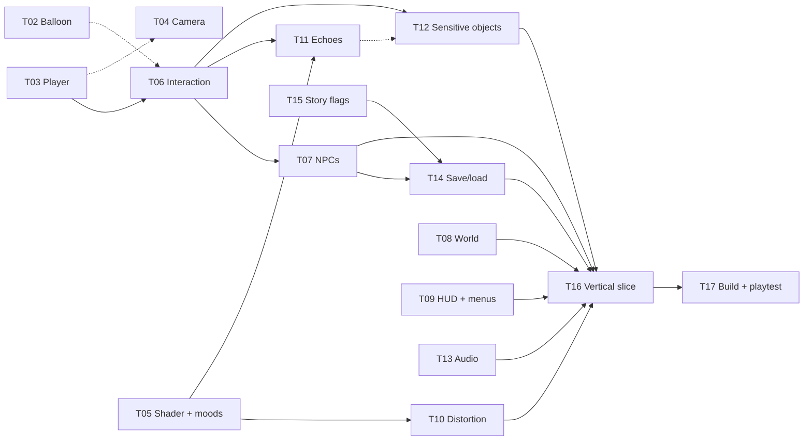

# oh-darling
A project for the 2026 Videogame Design and Programming (VDP) course at the Politecnico di Milano.

# (WIP) FOR DEVELOPERS!!!  Oh Darling: Project Guide
 
This file explains how the Godot project is built and how to work in it.
Read it before you add code. It is short on purpose and can be updated over time.
 
Game design: see `gdd.md`. Engine: Godot 4.x. Language: typed GDScript.
 
---
 
## 1. Folder map
 
```
core/        autoloads (the six managers)
data/        Resource scripts and .tres data (moods, schedules)
dialogue/    .dialogue files, one folder for each character
scenes/      scenes AND their scripts, grouped by feature
art/         models, textures, portraits, shaders
audio/       music stems and sound effects
addons/      plugins (do not edit)
```
 
Two rules:
 
- **Scene and script stay together.** `player.tscn` and `player.gd` live in the same folder.
- **All names use snake_case.** Example: `neon_padma.tscn`.
---
 
## 2. The six autoloads
 
An autoload is a script that Godot loads first and keeps for the whole game. Each one has ONE task.
 
| Autoload | Task | Owns |
| --- | --- | --- |
| `GameManager` | Runs the game state and the main loop | `state` |
| `TimeManager` | Keeps the clock. It moves only in dialogues | `day`, `minutes` |
| `EmotionManager` | Keeps the hidden emotions. Gives mood and Distortion | hidden values |
| `SaveManager` | Writes and reads the one autosave file | save file |
| `AudioManager` | Plays the music stems. Follows the mood | audio players |
| `UIManager` | Shows and hides menus and HUD | screen list |
 
Each script has a large comment at the top. It lists the task, the data, the signals and the rules. **Read that comment before you change the script.**
 
---
 
## 3. Rules for communication
 
These rules keep the code simple. They are the most important part of this file.
 
1. **Data changes in ONE place.** Only `EmotionManager` changes emotion values. Only `TimeManager` changes the clock. Other scripts ask, or listen.
2. **Managers do not call each other. They send signals.** `EmotionManager` sends `mood_changed`. The shader, the audio and the NPCs listen. `EmotionManager` does not know they exist.
3. **Do not use `_process()` to read a manager.** Connect to its signal.
4. **Listeners connect in `_ready()`.**
```gdscript
   func _ready() -> void:
       EmotionManager.mood_changed.connect(_on_mood_changed)
```
 
5. **Only `GameManager` opens a dialogue.** Call `GameManager.start_dialogue(resource, "start")`. Do not call `DialogueManager` directly. `GameManager` must set the state first.
6. **Data goes in `.tres` files, not in code.** Schedules, mood presets and similar values are Resources. Designers can then change them without a script.
7. **Do not show hidden numbers to the player.** The player reads the world.
### Who may call who
 
| From | May call |
| --- | --- |
| Dialogue files | `EmotionManager.shift()`, `TimeManager.advance()`, and the getters |
| `GameManager` | `SaveManager`, `TimeManager.reset()`, `EmotionManager.reset()` |
| `SaveManager` | `get_save_data()` and `load_save_data()` of the managers |
| Everything else | Only signals and getters |
 
---
 
## 5. Signals
 
| Signal | Sent by | Who listens |
| --- | --- | --- |
| `mood_changed(new_mood, old_mood)` | `EmotionManager` | `AudioManager`, Environment (shader), NPCs |
| `distortion_changed(new_level, old_level)` | `EmotionManager` | Environment (shader), Echoes |
| `time_changed(day, minutes)` | `TimeManager` | HUD clock, NPCs |
| `day_changed(day)` | `TimeManager` | NPCs |
| `state_changed(new_state, old_state)` | `GameManager` | `UIManager`, player controls |
| `game_saved`, `game_loaded` | `SaveManager` | nobody yet |
| `screen_shown(id)`, `screen_hidden(id)` | `UIManager` | nobody yet |
 
Mood names are strings: `"fog"`, `"overcast"`, `"clear"`, `"bright"`, `"storm"`.
 
---
 
## 6. The main loop in code
 
```
Player clicks an NPC
  └─ NPC calls GameManager.start_dialogue(resource, "start")
       ├─ state = DIALOGUE         (state_changed → UIManager)
       └─ the dialogue balloon opens
 
During the dialogue, a choice runs a mutation:
  ├─ do EmotionManager.shift("energy", 15)  → mood_changed → shader, audio, NPCs
  └─ do TimeManager.advance(20)             → time_changed → HUD, NPCs
 
The dialogue ends
  └─ GameManager.end_dialogue()
       ├─ SaveManager.save()
       └─ state = EXPLORATION
```
 
---
 
## 7. How to do common tasks
 
### Add a mood-dependent thing (for example, a new object)
 
1. Connect to `EmotionManager.mood_changed` in `_ready()`.
2. Read `EmotionManager.get_mood()` once, to set the first state.
3. Do **not** change the object while the player looks at it (GDD: Staging Rule). Swap it when it leaves the frame, or after a dialogue.
### Add an NPC
 
1. Copy the base scene `scenes/characters/npcs/npc.tscn`.
2. Make a schedule Resource in `data/schedules/`.
3. Make a folder in `dialogue/` for the character.
4. On click, call `GameManager.start_dialogue(...)`.
### Add a new screen
 
1. Make the scene in `scenes/ui/`.
2. In the UI root script: `UIManager.register_screen(&"my_screen", $MyScreen)`.
3. Add its rule in `UIManager._apply_state()`.
### Save new data
 
1. Give your script `get_save_data() -> Dictionary` and `load_save_data(data)`.
2. Add one line in `SaveManager.save()` and one line in `SaveManager.load_game()`.
3. Change `SAVE_VERSION` if old saves are no longer valid.
---
 
## 8. Code style
 
- Use **static types**: `var day: int = 1`, `func advance(amount: int) -> void:`.
- Use `##` for documentation comments on public functions and signals.
- Use tabs, not spaces.
- Start private names with `_`: `_recalculate()`.
- Name signals in the past tense: `mood_changed`, `dialogue_ended`.
- Do not use `class_name` in an autoload script. It conflicts with the autoload name.
- Keep functions short. If a function has more than about 30 lines, split it.
---
 
## 9. Working in a team (Git)
 
- **Each person owns a folder.** Suggested: one person for `core/`, one for `dialogue/`, one for `art/` and `audio/`, one for `scenes/world/`, one for `scenes/ui/`. Ask the owner before you change a file in their folder.
- **Do not edit the same `.tscn` file at the same time.** Godot scene files do not merge well. Say in the group chat when you take a scene.
- **Use small commits and short branches.** Merge into `main` often.
- **Do not commit** the `.godot/` folder.
---
 
## 10. Open questions
 
The team must decide these. They are also marked `TODO` in the scripts.
 
1. **Autosave timing.** Now: when a dialogue ends. The core loop says: after each choice. If we save after each choice, what does "Continue" do for a player who quit in the middle of a dialogue?
2. **Emotion axes.** Now there is one axis (`energy`). How many does the story need?
3. **Distortion.** For how it comes from the axis only.
4. **Midnight.** What happens when the clock passes 24:00?
5. **Mood presets.** Thresholds are constants now. They should move to `MoodPreset` `.tres` files.

# TASKS
# Oh Darling: Task List

This part lists most programming tasks for the prototype.
Each task is one unit of work for **one** programmer.

---

## 1. Overview

| ID | Task | Depends on | Main folder |
| --- | --- | --- | --- |
| T00 | Foundation (autoload stubs, README, settings) | none | `core/`, `project.godot` |
| T01 | Debug panel | none | `scenes/debug/` |
| T02 | Dialogue balloon (Disco Elysium style) | none | `scenes/ui/dialogue_ui/`, `dialogue/` |
| T03 | Player and click-to-move | none | `scenes/characters/player/` |
| T04 | Isometric camera rig | T03 (soft) | `scenes/camera/` |
| T05 | Painterly shader and mood presets | none | `art/shaders/`, `data/moods/` |
| T06 | Interaction system | T03 | `scenes/interactables/` |
| T07 | NPC base and schedules | T06 | `scenes/characters/npcs/`, `data/` |
| T08 | World greybox and locations | T03 (soft) | `scenes/world/` |
| T09 | HUD and menus | none | `scenes/ui/` |
| T10 | Distortion effects | T05 | `art/shaders/` |
| T11 | Echoes | T05, T06 | `scenes/interactables/echoes/` |
| T12 | Sensitive objects | T06, T11 (soft) | `scenes/interactables/sensitive/` |
| T13 | Audio: stems, tuning, effects | audio files | `audio/`, `core/audio_manager.gd` |
| T14 | Save and load completion | T07, T15 | `core/save_manager.gd` |
| T15 | Story flags | lead approval | `core/` |
| T16 | Vertical slice: one full in-game day | all | everyone |
| T17 | Build, export and playtest | T16 | `export_presets.cfg` |

"Soft" means: you can start without it. Use a stub (a fake, simple version) and connect the real one later.

### Dependency diagram

The diagram shows only the hard dependencies. (GitHub and GitLab draw it. Use a Mermaid viewer if your editor does not.)



---

## 2. Task overviews

### T00: Foundation

The structure that all other tasks use: the six autoload stubs, `README.md`, the folders, the Input Map (`pause`), the audio bus `Music` and the `Main` scene. The lead owns this task. It is done when the project opens and runs with no errors, and all autoloads load in the order given in the README.

### T01: Debug panel

A debug overlay that opens with F1 and exists only in debug builds (`OS.is_debug_build()`). It shows the game state, the mood, the Distortion level and the day and time. It has buttons to change energy (−20 and +20), advance time (10 and 60 minutes) and reset emotion and time. It uses only the public API of the managers, so every programmer can test their own task without playing the game. `EmotionManager` does not give the raw value yet, so the lead must add a `debug_get_axis(name)` getter for debug builds.

### T02: Dialogue balloon

The Disco Elysium style dialogue screen, built as a custom balloon for the Dialogue Manager plugin: a scrolling log of lines, inner voices, numbered choices, locked choices, and a theme that follows the mood. The balloon opens only through `GameManager.start_dialogue()`. If the plugin does not send `dialogue_ended`, the balloon calls `GameManager.end_dialogue()` when it closes. It may call `GameManager.on_choice_made()` after each choice to trigger an autosave. This task also delivers `dialogue/_test/test.dialogue` (a mood condition, an emotion mutation and a time mutation), which all other tasks use as a stub.

### T03: Player and click-to-move

A `CharacterBody3D` with a `NavigationAgent3D`. A click on the ground sends a ray from the camera and the player walks to that point. The player reacts to clicks only in the `EXPLORATION` state and stops in `DIALOGUE` (listen to `GameManager.state_changed`). Contract: group `player`, `move_to(position, stop_distance)`, signal `arrived`, and `set_input_enabled(enabled)`. Build and test it in `scenes/_sandbox/player_sandbox.tscn` (a flat floor, a navigation region and a few obstacles).

### T04: Isometric camera rig

A fixed-angle isometric camera that follows a `target` (`Node3D`) with smooth movement. It reacts to `mood_changed` with a `Tween`: in Storm it sways a little, and in Fog it moves back so the player looks small. Use constants for the values at first, then move them into `MoodPreset` when T05 is ready.

### T05: Painterly shader and mood presets

The five painted looks, made with **one** shader (a README rule). The task has three parts: the `MoodPreset` Resource with five `.tres` files; an `EnvironmentController` on the `Environment` node that listens to `mood_changed` and tweens the values to the new preset in about 1 to 2 seconds; and the shader. Build the color change first (hue, saturation, value, light color, fog), then the painted look (palette, brush size, edges). `MoodPreset` fields: `mood`, `hue_shift`, `saturation`, `value`, `palette`, `brush_size`, `light_color`, `light_energy`, `fog_density`, `camera_sway`, `camera_distance`, `ui_theme`. The game must stay at 60 FPS on a normal laptop.

### T06: Interaction system

One base scene for everything the player can click. It has a collision shape, a hover highlight and a cursor change. On a click, the player walks to the `interaction_point`, and on `arrived` the base calls `GameManager.start_dialogue(dialogue_resource, dialogue_title)`. It does nothing when the state is not `EXPLORATION`. Contract: `@export dialogue_resource`, `@export dialogue_title` (default `"start"`), `@export interaction_point` (`Marker3D`), and `can_interact() -> bool`, which child scenes override. Use `dialogue/_test/test.dialogue` until T02 is ready.

### T07: NPC base and schedules

NPCs with a daily routine (GDD: strict schedule). `NpcData` holds `id`, `display_name`, `portrait` and a list of `ScheduleEntry`. Each `ScheduleEntry` holds `start_hour`, `end_hour` and `spot_id`. The NPC scene extends `Interactable`. It listens to `TimeManager.time_changed`, finds the active entry with `TimeManager.is_between()`, and goes to the matching spot (a `Marker3D` in group `spots`). With no active entry, the NPC is away and `can_interact()` returns `false`. Schedules live in `.tres` files only. Roger (rests at night) and Neha (at the bar) are the first two NPCs.

### T08: World greybox and locations

A walkable town made of simple boxes: Town Hall with the basement archive, the Square, the Neon Padma, the Park and shelter, the protagonist's home and two stores. It has one `NavigationRegion3D`. Each place has a `Location` node with a `LocationData` Resource (`id`, `open_hour`, `close_hour`), and `is_open()` reads `TimeManager`. A closed door shows a one-line inner thought through a short dialogue. The scene also holds the `spots` markers that T07 needs. Keep node and scene names stable, because the final art replaces the boxes later.

### T09: HUD and menus

The screens around the game. The HUD shows the clock ("Day 1, 07:00") and listens to `time_changed`. The main menu has New Game, Continue (disabled when `SaveManager.has_save()` is false) and Quit. The pause menu has Resume and Back to menu, with `process_mode` set to "When Paused". All screens register with `UIManager.register_screen(...)`. The UI never shows the hidden emotion values.

### T10: Distortion effects

The three visual Distortion levels from the GDD table, driven by `distortion_changed`. Level 1 sends a signal for small anomalies (T11 and T12 use it). Level 2 makes the room sway or tilt, with a camera roll and a shader wobble. Level 3 breaks the scene into fragments. At level 0 the effect is off and costs nothing.

### T11: Echoes

Things the player sees that are not real. An `Echo` scene has a tone that follows the mood: Storm is grand (golden light, admiring faces), Fog is threatening (faces turning away, accusing objects). An `EchoSpot` marker holds `echo_scene`, a `mood` filter and `min_distortion`. The staging rule applies: an Echo appears or disappears only when it is outside the camera view (`VisibleOnScreenNotifier3D`) or after a dialogue. This task builds that rule as a reusable node named `OffscreenSwapper`, which T12 also uses.

### T12: Sensitive objects

The window, the mirror and the door, which change with the mood. `SensitiveObject` extends `Interactable`. A Resource maps each mood to a dialogue title, a description and a visual variant. In Overcast and Bright the object stays the same but its meaning changes. In Fog and Storm it shows an Echo. Swaps use `OffscreenSwapper` from T11, or happen only after a dialogue if it is not ready yet.

### T13: Audio: stems, tuning, effects

The real soundtrack in `AudioManager`. Replace the placeholder stem names with the real ones and set loop in the import settings. Tune the `MOOD_VOLUMES_DB` table with the composer. Add `play_sfx(name)` and a small list of effects (click, footsteps, door). The five moods must sound different, the stems must stay in sync, and the loop must have no click.

### T14: Save and load completion

Complete the save file. Add the story flags, NPC state (if it changes), the player position and the Dialogue Manager variables. Finish the Continue flow and handle a broken save file with a clear message and no crash. The game keeps autosave only: no manual save and no second slot.

### T15: Story flags

One place for story facts, such as "the player met Roger". Write a half-page proposal first. The lead approves it, because it may add a new autoload. The suggested content is a `Dictionary` of flags with `set_flag()`, `has_flag()`, the signal `flag_changed`, and `get_save_data()` / `load_save_data()`. Dialogue files use it like this: `[if StoryFlags.has_flag("met_roger")]`.

### T16: Vertical slice, one full in-game day

The whole team builds one complete day, from start to end. It has Roger, Neha and the Mayor with their real schedules, and the mood goes through at least Clear, Bright and Storm (or Fog). The team plays the day many times and writes the bugs on the board, and each programmer fixes the bugs in their own area. A new player must be able to play the day (20 to 40 minutes) with no crash, and a time conflict between two NPCs must have a visible consequence. The lead leads this task.

### T17: Build, export and playtest

Export presets for Windows and Linux, a test on a clean computer, a check of the basic settings (volume, window), and a list of known bugs. Someone outside the team should run the build and play for 10 minutes.

---

## 3. If we are late: what to cut

Cut in this order. Do not cut a task that is higher in the list.

1. T17 polish (extra settings) and T13 sound effects
2. T12 Sensitive objects (keep only the mirror)
3. T10 Distortion level 3 (fragmentation)
4. T05 second shader version (keep the color change only)
5. T11 Echoes (keep only one Echo for each mood)

**Never cut:** T02, T03, T06, T07, T14 and T16. Without them there is no game.
